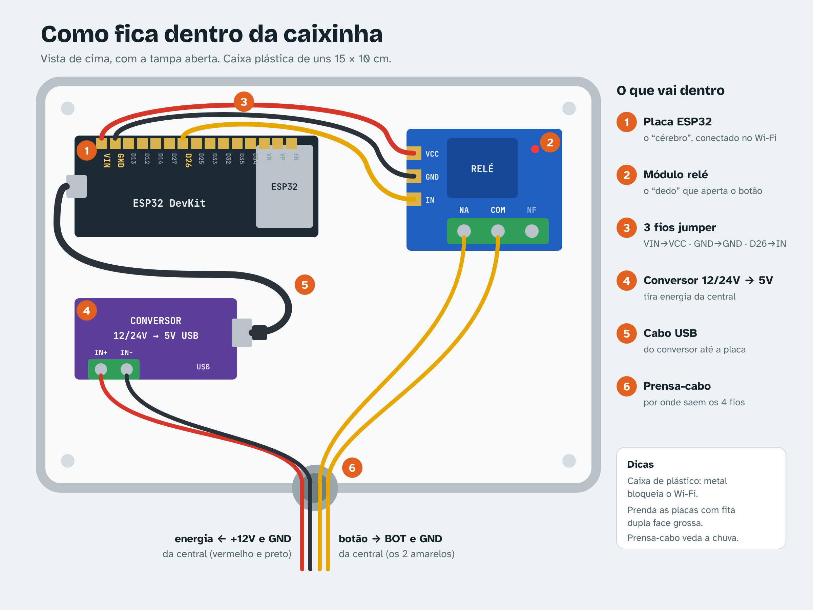

# Guia de instalação — ESP32 AuggeControl

Não precisa programar nem instalar nada no computador. Todo o processo é guiado pelo app em
**Portões e dispositivos → Instalar equipamento** (`/instalar`).

## 1. O que comprar

| Item | Observação | Preço aprox. |
|---|---|---|
| **ESP32 DevKit V1** (30 ou 38 pinos, com USB) | Evite ESP32-CAM e ESP8266 | R$ 35–50 |
| **Módulo relé 5 V, 1 canal** | 2 canais se forem 2 portões ou abrir/fechar separados | R$ 10–20 |
| **3 jumpers fêmea-fêmea** | Só encaixam, sem solda: VIN→VCC, GND→GND, D26→IN | R$ 5 |
| **Cabo USB de dados** + carregador de celular | Alguns cabos só carregam — se a placa não aparecer, troque o cabo | — |
| **Caixinha plástica** | Para proteger da chuva (só na instalação final) | R$ 10–20 |
| **Conversor 12/24 V → 5 V USB** (“buck 12v 24v 5v usb”) | Só na instalação final, para tirar energia da central do motor | R$ 15–30 |
| *Opcional:* sensor magnético (reed switch) | Mostra no app se o portão está aberto/fechado | R$ 10–15 |

> O Wi-Fi do ESP32 é **2,4 GHz**. Redes só 5 GHz não funcionam.

Placas “ESP32 com relé integrado” também funcionam, mas muitas não têm USB e usam outros pinos
(ajuste em “Pinos dos relés” na página de configuração da placa) — só para técnicos.

## Teste em casa, sem portão

Dá para testar tudo antes: grave, pareie e toque em **Acionar** no app. O relé faz um **“clique”**
e acende um **LED** no módulo; o app mostra **“Comando executado”**. É exatamente o mesmo sinal que,
depois, o técnico liga na botoeira do portão. Tudo em 5 V do USB, sem risco de choque.

## 2. Gravar o AuggeControl na placa (2 minutos)

1. Num **computador** com **Chrome ou Edge**, abra o app → **Instalar equipamento**.
2. Ligue a placa no USB e clique em **Instalar AuggeControl na placa**.
3. Escolha a porta (“USB Serial”, “CP210x” ou “CH340”) e aguarde chegar a 100%.

Se a placa não aparecer: troque o cabo ou instale o driver CP210x / CH340.
Se ficar parado em “Connecting…”, segure o botão **BOOT** da placa até começar.

## 3. Conectar à sua conta (pelo celular)

1. No app, gere o **código de pareamento** (8 letras/números, vale 30 minutos, uma vez só).
2. Ligue a placa na energia. Ela cria uma rede Wi-Fi chamada **AuggeControl-XXXX**.
3. No celular, conecte nessa rede. Abre uma página (se não abrir, acesse **192.168.4.1**).
4. Escolha o Wi-Fi da casa, digite a senha e o código. Toque em **Conectar**.
5. Em segundos o app mostra o equipamento **online**.

Para refazer (trocar de Wi-Fi, por exemplo): **segure o botão BOOT por 5 segundos**; a placa volta
a criar a rede AuggeControl-XXXX.

## 4. Ligar no portão (chame um técnico de portão)



Vale para qualquer motor: de correr, pivotante, basculante ou levadiça. A placa e o relé vão numa
caixinha plástica ao lado do motor, ligada na central com 4 fios. Mostre ao técnico:

```
Botão: ligar COM e NA do relé nos bornes de BOTOEIRA da central (BOT / PUL / START),
em paralelo com o botão/receptor. Contato seco, sem tensão.
Energia: saída auxiliar +12/24 V e GND da central (a mesma da fotocélula) → conversor DC-DC
12/24 V para 5 V USB (mín. 1 A), dentro da caixa; cabo USB na placa.
Não ligar 12/24 V direto no VIN. Não ligar na rede 127/220 V do motor.
Sensor opcional: um fio no GPIO 32, outro no GND.
```

Sem saída auxiliar na central? Use um carregador de celular numa tomada perto do motor.

Depois, cadastre o portão em **Portões e dispositivos** (Relé 1, tipo Pulso) e teste pelo app.
Em condomínio, use **Residências → Vincular portões** (em casa comum é automático).

## 5. Problemas comuns

| Sintoma | Causa provável |
|---|---|
| Página “código inválido” | Código expirou ou já foi usado — gere outro no app |
| Não conecta no Wi-Fi | Rede 5 GHz, senha errada ou sinal fraco |
| Rede AuggeControl-XXXX não aparece | Placa já configurada — segure BOOT 5 s |
| Relé clica mas portão não mexe | Fios na botoeira errada ou usando NF em vez de NA |
| Portão repete o movimento | Pulso longo demais: diminua a duração no cadastro do portão |
| Fica offline às vezes | Sinal fraco (abaixo de −80 dBm no diagnóstico é ruim) |

## Para desenvolvedores

O GitHub Actions (`.github/workflows/firmware.yml`) compila `auggecontrol-esp32.ino` a cada
mudança e publica `web/public/firmware/`. Para apontar para outra API, crie `config.h` a partir de
`config.exemplo.h`. Monitor Serial em 115200 mostra conexões e comandos.
