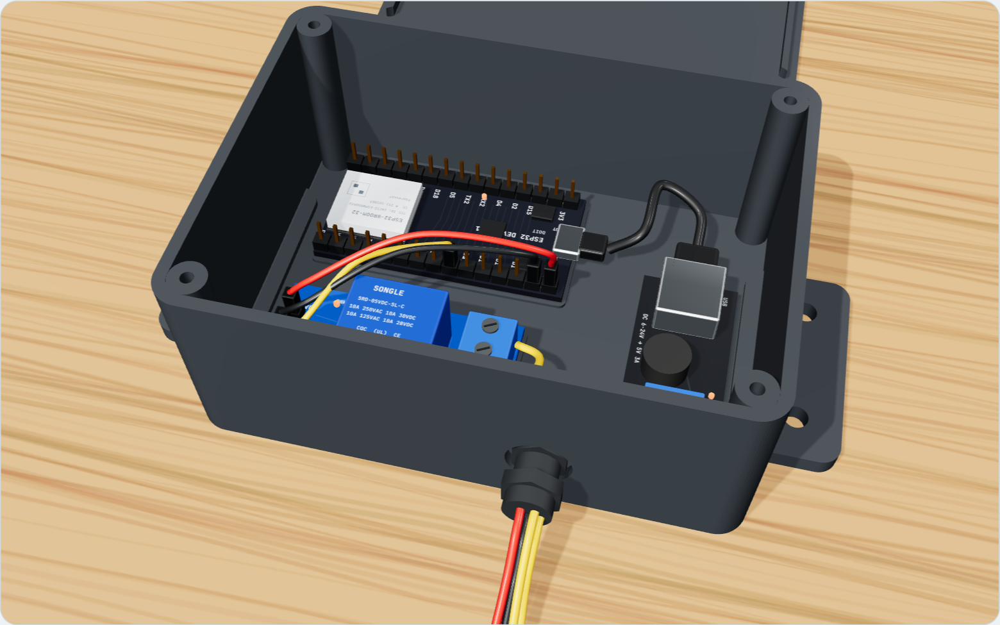
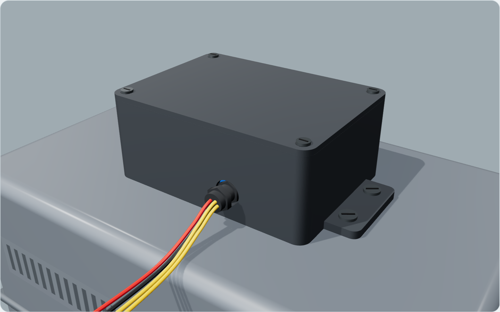

# Caixa do AuggeControl para impressão 3D

## Arquivos

| Arquivo | O que é |
|---|---|
| `caixa-auggecontrol.stl` | Corpo da caixa, com orelhas de fixação e furo do prensa-cabo |
| `tampa-auggecontrol.stl` | Tampa com aba de vedação e 4 furos escareados |
| `gerar_caixa.py` | Gera os STL de novo se precisar mudar alguma medida |

## Medidas

- Por fora: **108,8 × 78,8 × 42,4 mm** (140,8 mm de largura contando as orelhas). A tampa soma 2,6 mm.
- Por dentro: 104 × 74 × 40 mm.
- O fundo tem marcas em relevo mostrando onde colar o ESP32, o relé e o conversor.

## Como imprimir (para quem for imprimir)

| Ajuste | Valor |
|---|---|
| Material | **PETG** ou **ASA** (aguentam sol e calor). Evite PLA: deforma ao sol |
| Camada | 0,2 mm |
| Paredes | 3 perímetros |
| Preenchimento | 25 % |
| Suporte | Não precisa (o furo do prensa-cabo é pequeno) |
| Posição | Caixa com o fundo na mesa; tampa com a face lisa na mesa (já vem virada no arquivo) |

## O que comprar junto

- **Prensa-cabo PG7** (para cabos de 3 a 6,5 mm): rosqueia no furo da frente e veda os 4 fios.
- **4 parafusos M3 × 10 mm** para a tampa (entram direto no plástico).
- Para fixar no motor:
  - **com parafusos:** 4 parafusos de 4 mm (autoatarraxantes de chapa, ou com bucha 6 se for em parede);
  - **ou colada:** fita dupla face VHB (3M) ou cola PU/silicone no fundo reto.
- Fita dupla face grossa para prender as 3 placas dentro.

## Dica

Não prenda a caixa em cima da tampa do motor que precisa ser aberta para manutenção:
prefira a lateral fixa do motor, o pilar ou a parede ao lado.
